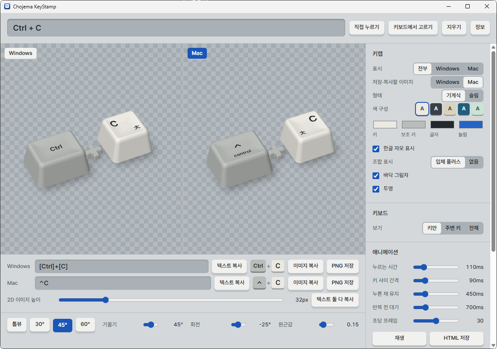
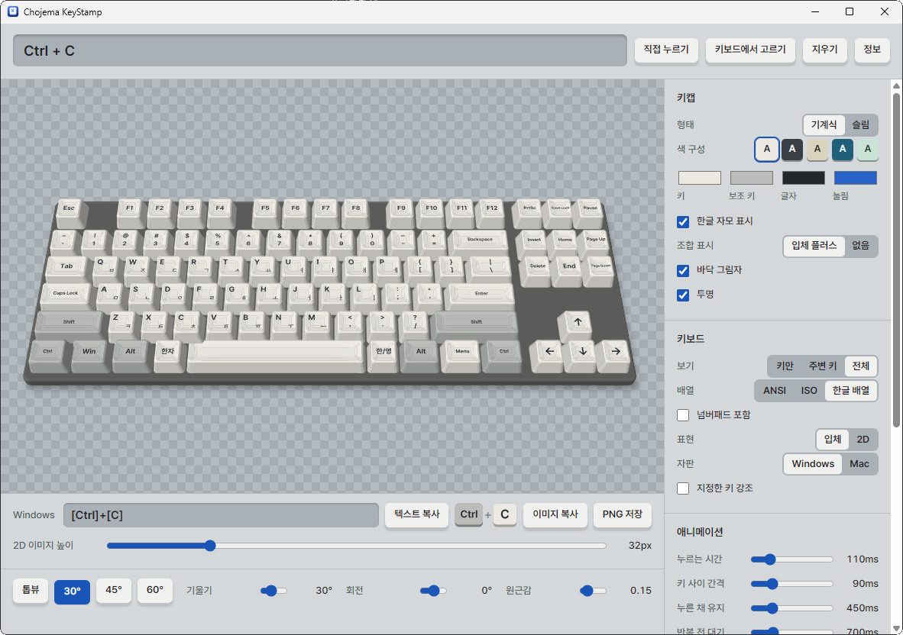
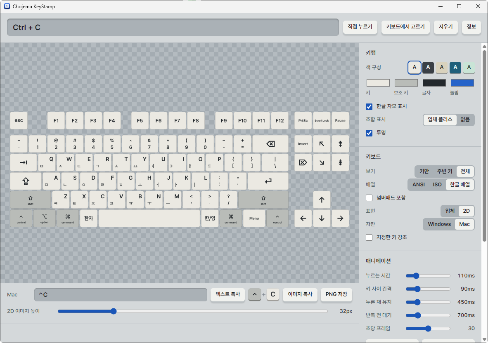

# Chojema KeyStamp

[한국어](README.md) | English

A desktop app that creates keycap images and animations.

## Download

Get the Windows installer or macOS Universal DMG from the [latest release](https://github.com/chojema/chojema-keystamp/releases/latest). The macOS app supports Apple Silicon and Intel Macs. Open the DMG and drag the app to Applications.

The macOS app has no Developer ID signature or Apple notarization, so Gatekeeper may show a warning.

The Windows installer is not code signed, so Windows SmartScreen may warn you the first time you run it. Select `More info`, then `Run anyway`, to install.

## Screenshots

All three screenshots show v0.3.0 running on Windows. The Windows and Mac choices in the interface refer to the key labels and keyboard layout used in the output.

**Compare key combinations**

View Windows and Mac keycaps for `Ctrl + C` side by side, with Hangul letters and text results.



**Full keyboard in 3D**

View the complete Windows keyboard in 3D, using the Korean layout with Hangul letters.



**Full keyboard in 2D**

View the complete Mac keyboard as a flat image. Under Keyboard, choose Full, then set Appearance to 2D.



## Features

- **Key entry:** Type `C`, `Ctrl + Shift + Z`, or `⌘⇧Z`, press the keys, or choose them on an on-screen keyboard.
- **Windows and Mac:** Show images and results for both, Windows only, or Mac only. `Win` matches `⌘`, `Ctrl` matches `⌃`, and `Alt` matches `⌥`.
- **Angles:** Use the top, 30°, 45°, and 60° presets, or drag to rotate.
- **Export:** Save SVG and PNG files, or copy to the clipboard.
- **Text results:** Copy text such as `[Ctrl]+[Shift]+[Z]`, `⊞+[E]`, and `⌃⇧Z` into documents, separately or together.
- **2D images:** Copy or save flat keycap PNGs that fit inside a sentence.
- **Surrounding keys:** Optionally show nearby keys with blurred edges, on ANSI, ISO, and Korean layouts.
- **Full keyboard:** Create images and animations of the whole keyboard, as is or with chosen keys highlighted. Choose Windows or Mac keys, and whether to include the number pad.
- **Full keyboard in 2D:** Under Keyboard, choose Full, then set Appearance to 2D for a crisp, flat keyboard. Copy and export preserve the platform, layout, number pad, Hangul letters, and highlight settings. The existing 3D view remains the default.
- **Hangul letters:** Show Latin and Hangul letters together, arranged for Windows or Mac.
- **Animation:** Save key presses as HTML, GIF, or APNG.
- **About:** Use About in the top bar to see author information and links to the GitHub repository and Chojema App Park. Links open in the default browser.

## Good to know

- Keys that the operating system handles first, such as `Ctrl + Alt + Del`, `Win + L`, and `Cmd + Tab`, can't be captured by pressing them. Type them in the input field instead.
- Keys match one to one. The Mac result for `Ctrl + C` is `⌃C`, not `⌘C`.
- GIF has no partial transparency. Use APNG when you need a transparent background.
- The app interface follows your system language: Korean for Korean systems and English for all others.

## Build

Requires Node.js and Rust.

```
npm ci
npx tauri build
```

## Copyright

© Chulwoo Park. All rights reserved.

Notices for the included open source components are available under `Open source notices` in the app. Windows is a trademark of Microsoft Corporation. Mac and macOS are trademarks of Apple Inc. This app is not affiliated with either company.
